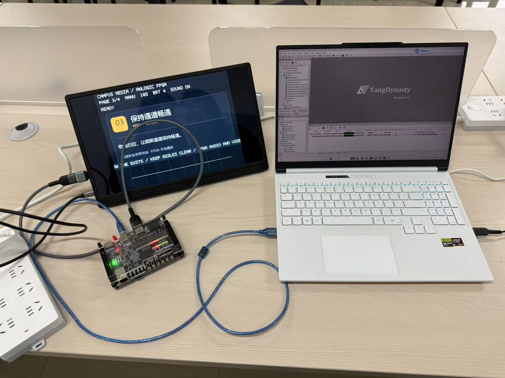
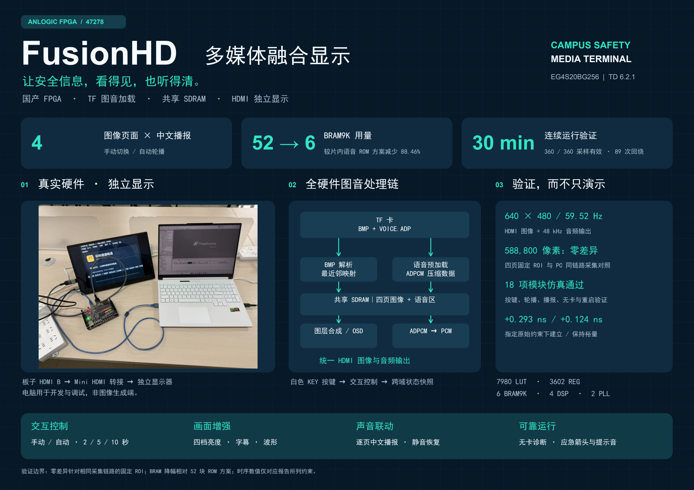
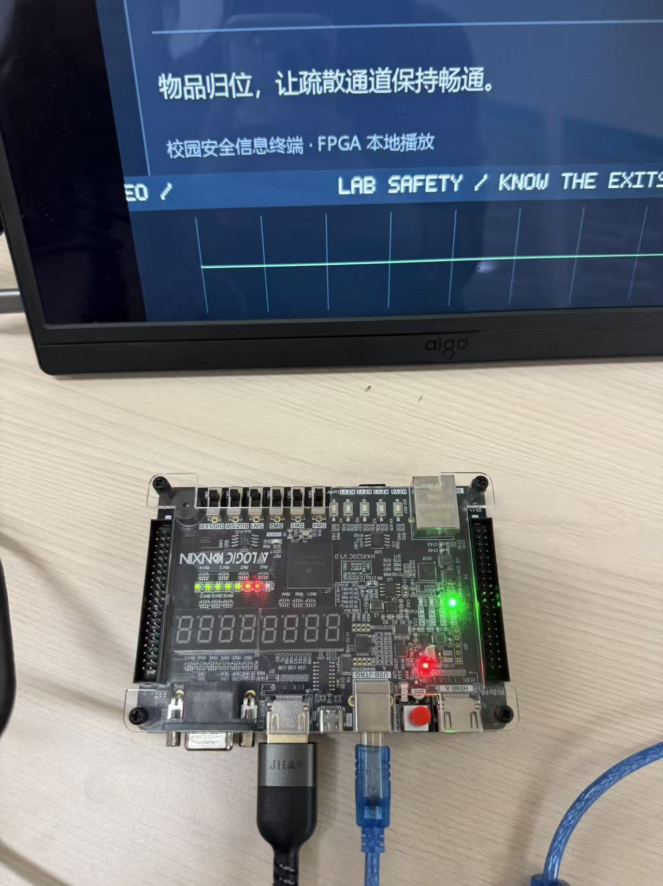
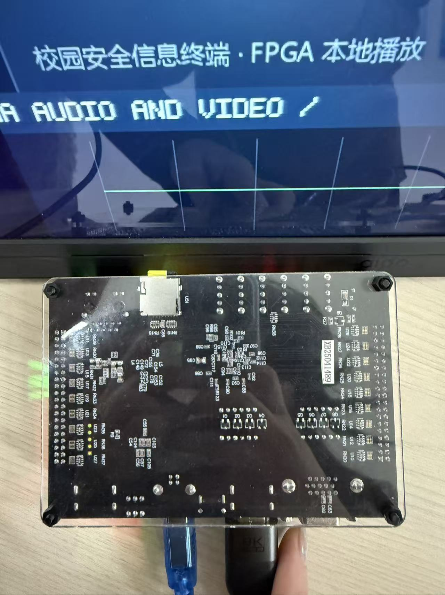

# FusionHD 多媒体融合显示系统
**基于安路 EG4S20 FPGA 的校园安全音视频终端**

FusionHD 从 TF 卡读取校园安全图片与中文语音，通过 FPGA 完成图像加载、缓存、画面合成和语音解码，经 HDMI 直接驱动独立显示器，实现图文展示、中文播报与应急提示。

本仓库用于公开展示项目成果，完整源码与开发工程由团队私有保存。



## 功能介绍

- **图片展示**：四页 BMP 图片手动切换或自动轮播，支持末页回到首页。
- **图像适配**：支持 640×480 原尺寸显示，以及 320×240 图像的二倍最近邻放大。
- **中文播报**：播放与页面对应的中文安全提示，支持静音和恢复。
- **交互控制**：支持四档亮度、自动／手动切换，以及 2／5／10 s 最短轮播间隔。
- **信息叠加**：显示页码、播放模式、亮度、声音状态、滚动文字和 PCM 波形。
- **应急模式**：通过按键切换应急提示画面、方向箭头及提示音。
- **独立运行**：固化后可在正常 TF 卡条件下断电恢复，无需电脑参与运行时媒体处理。

> 当前系统面向图片与语音融合展示，不属于通用视频文件播放器。正式演示素材为四张 640×480 图片。

## 系统方案

系统采用 RTL 实现核心处理逻辑，主要数据通路如下：

```text
TF 卡 BMP 图片 → 图像加载与缩放 → SDRAM 图像缓存 ─┐
                                                ├→ 图像合成与 HDMI 输出 → 显示器
白色 KEY 按键 → 交互控制与状态同步 ──────────────┤
                                                │
TF 卡压缩语音 → 语音预加载 → 共享 SDRAM → 语音解码 ┘
```

图像与压缩语音共享外部 SDRAM。将语音存储由片内 ROM 迁移至共享 SDRAM，降低了片上块存储占用。

## 硬件平台

| 项目 | 配置 |
|---|---|
| FPGA | 安路 EG4S20BG256 |
| 开发板 | HX4S20C V1.0 |
| 开发工具 | Tang Dynasty 6.2.1 |
| 设计方式 | RTL 硬件逻辑 |
| 功能仿真 | ModelSim |
| 媒体存储 | TF 卡与共享 SDRAM |
| 音视频输出 | HDMI B |

### 显示连接

**独立运行：**

```text
开发板 HDMI B → HDMI 线／匹配转接头 → 显示器 HDMI 输入
```

显示器按其要求单独供电。使用 Mini HDMI 输入的显示器时，需要匹配的转接头或线缆。

**电脑采集预览：**

```text
开发板 HDMI B → 采集卡 HDMI Input → 电脑 USB／Type-C
```

笔记本通过 USB 采集卡接收画面和声音，笔记本自身的 HDMI 接口不作为输入接口。

## 按键说明

操作使用板上的**白色 KEY 按键**，不是黑色 SW 开关。

| 按键 | 短按 | 长按约 2 秒 |
|---|---|---|
| KEY1 | 复位 | 复位 |
| KEY2 | 下一页 | 静音／恢复语音 |
| KEY3 | 切换亮度 | 进入／退出应急模式 |
| KEY4 | 自动／手动切换 | 切换轮播间隔 |

## 验证结果

开发采用模块仿真与板级验证迭代的流程，结合资源统计、静态时序分析和实板回归检查系统行为。

| 验证项目 | 已记录结果 |
|---|---|
| 模块功能仿真 | 18 项 RTL 功能测试通过 |
| 图像一致性 | FPGA 与 PC 参考源共用采集链路，四页固定 ROI 合计 588800 像素比较无差异 |
| 块存储优化 | BRAM9K 由 52 块降至 6 块，下降 88.46% |
| 当前物理资源 | 7980 LUT、3602 REG、6 BRAM9K、4 DSP、2 PLL |
| 连续运行 | 1799.97 s，完成 89 次页面循环回绕 |
| 语音播放 | 四句提示语各完成 89～90 次完整播报 |
| 可靠性检查 | 配置回读、正常卡断电恢复、无卡诊断和应急输出通过验证 |

图像比较结果仅对应指定素材、固定 ROI 和已记录采集条件，不代表任意图像或全帧链路均无损。模块仿真、内部时序分析与实板测试分别验证不同层面的行为，不能相互替代。

## 项目演示

- [观看演示视频（约 2 分 16 秒）](media/FusionHD-demo.mp4)
- [查看作品海报（PDF）](docs/FusionHD-poster.pdf)



### 开发板照片





## 仓库内容

```text
FusionHD/
├── README.md
├── images/       # 项目实拍与海报预览
├── media/        # 演示视频
└── docs/         # 展示海报
```

本仓库不包含完整 RTL 源码、TD 工程、固件、TF 卡镜像、签名承诺书及队员个人信息。比赛所需完整工程通过指定提交渠道另行提供。

## 使用说明

本仓库为项目展示仓库，未授予开源使用许可。如需转载展示资料或开展合作，请先与团队联系。第三方商标及材料的权利归相应权利人所有。
