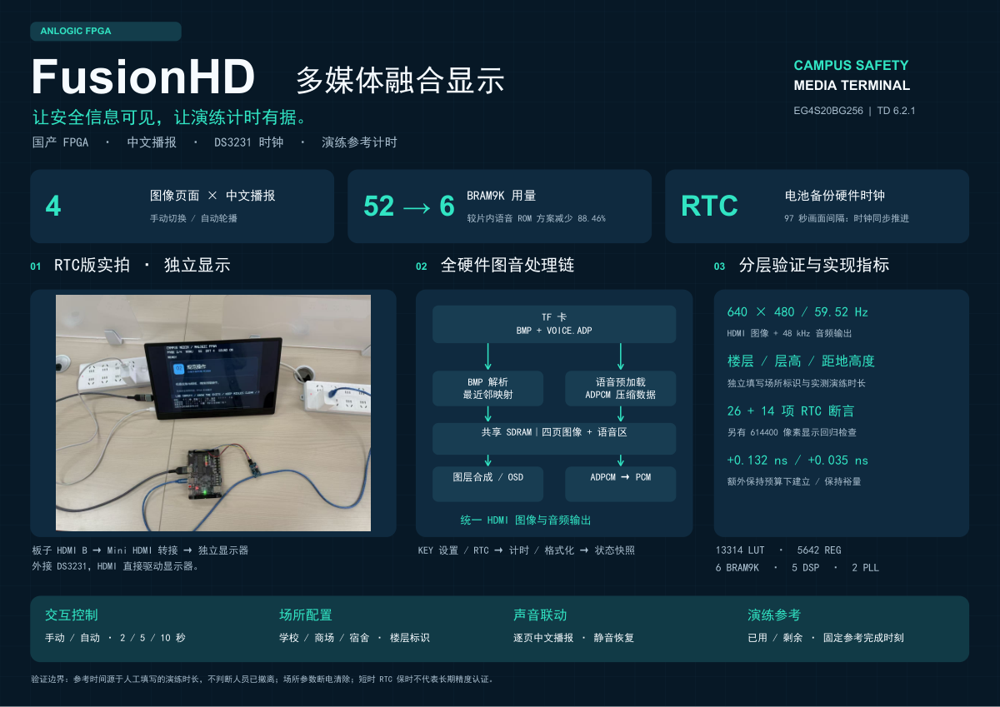
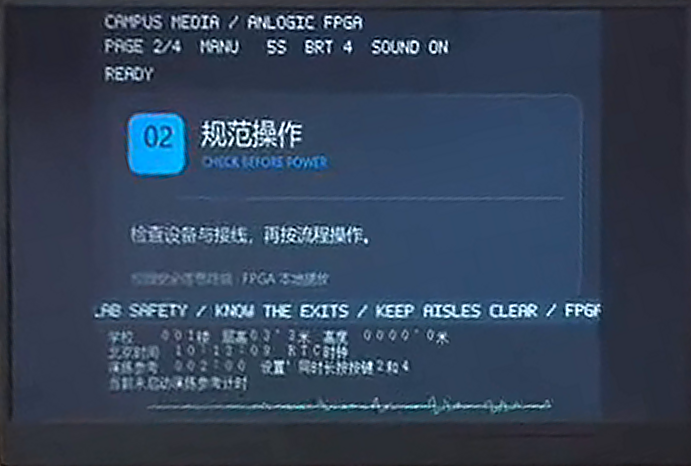
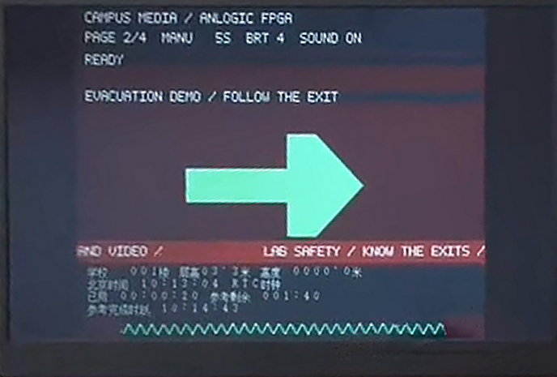
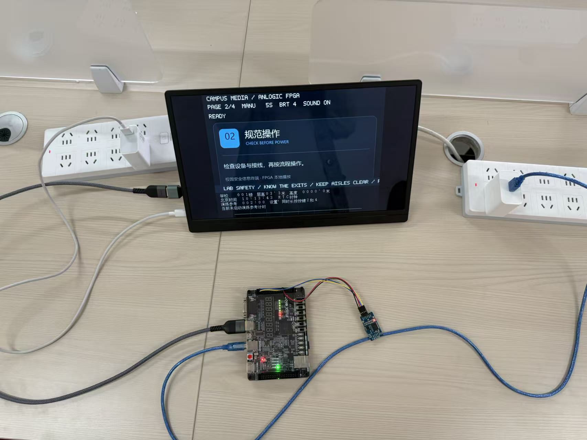
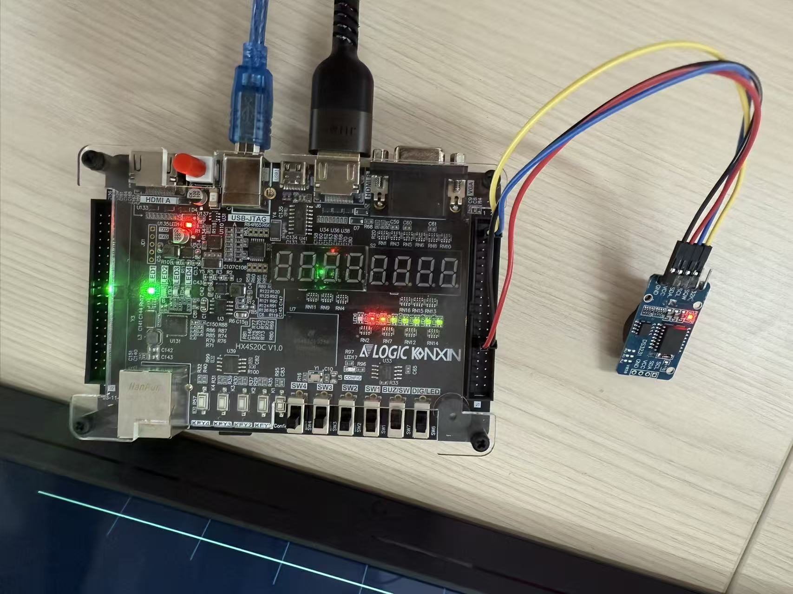
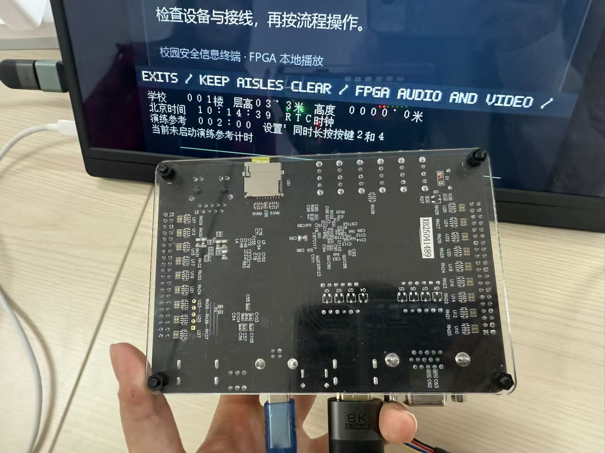
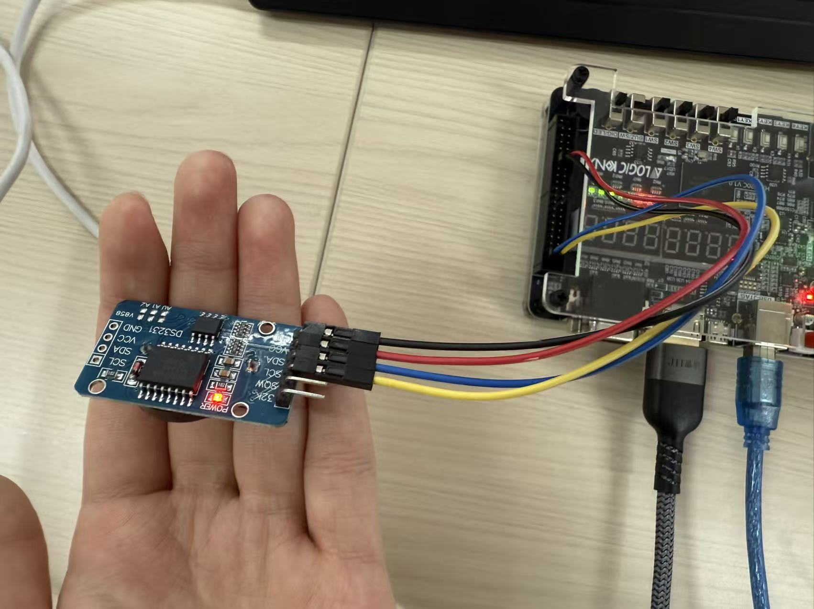
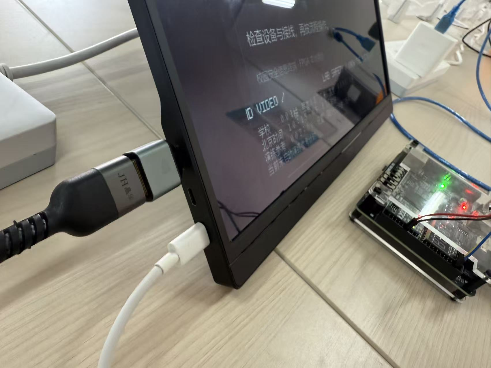



<h1>FusionHD</h1>

<h3>多媒体融合显示系统</h3>

<em>Multimedia Fusion Display System — an FPGA-based terminal for campus safety notices, 
Chinese voice playback and evacuation-drill timing</em>

<strong>基于安路 EG4S20BG256 FPGA 的校园安全图文、中文播报与演练参考终端</strong>

图片与压缩语音从 TF 卡加载，经共享 SDRAM 缓存，由板子 HDMI B 直接驱动独立显示器。 
电脑仅用于开发与下载，运行时不参与媒体处理。

作品海报 · 点击查看 PDF 原图

---

## 🖥️ 界面预览

<table>
  <tr>
    <td width="50%" align="center"> <b>常规信息页</b> · 图片、中文播报与底部状态栏</td>
    <td width="50%" align="center"> <b>应急模式</b> · 箭头指示、已用 / 剩余时间与 PCM 波形</td>
  </tr>
</table>

## ✨ 功能亮点

| 能力 | 说明 |
|---|---|
| **四页图文轮播** | BMP 手动 / 自动切换，末页回绕，2 / 5 / 10 s 最短间隔，四档亮度 |
| **中文语音播报** | 压缩语音从 TF 卡加载并解码，HDMI 音频输出，支持静音与恢复 |
| **双分辨率支持** | 640×480 原尺寸，以及 320×240 二倍最近邻放大 |
| **场所与演练配置** | 学校 / 商场 / 宿舍等场所、楼层、层高、距地高度与实测演练时长 |
| **硬件时钟** | DS3231 RTC 显示人工校准的北京时间，短时断电后恢复走时 |
| **应急演练参考** | 应急箭头、已用 / 剩余时间、锁定的参考完成时刻、超时提醒与提示音 |
| **实时波形** | 屏幕底部显示真实 PCM 波形与运行状态 |

## 🧩 硬件与连接

| 项目 | 配置 |
|---|---|
| FPGA | 安路 EG4S20BG256 |
| 开发板 | HX4S20C V1.0 |
| 开发工具 | Tang Dynasty 6.2.1 |
| 媒体存储 | TF 卡 + 共享 SDRAM |
| 时钟 | DS3231 硬件 RTC（I²C） |
| 输出 | HDMI B → 显示器 HDMI 输入 |

> 使用 Mini HDMI 输入的便携显示器时，显示器端需要匹配的 Mini HDMI 转接头，并按显示器要求单独供电。电脑用于开发与下载；早期预览通过 HDMI 采集卡接入电脑 USB，笔记本 HDMI 接口不作为视频输入。

## 🎛️ 按键操作

操作对象为白色 **KEY** 按键，非黑色 SW 开关。

| 按键 | 短按 | 长按（约 2 s） |
|:---:|---|---|
| KEY1 | 复位 | 仍为复位 |
| KEY2 | 下一页 | 静音 / 恢复语音 |
| KEY3 | 切换亮度 | 进入 / 退出应急模式 |
| KEY4 | 自动 / 手动 | 切换轮播间隔 |

**进入设置**：组合长按 `KEY2 + KEY4` → `KEY4` 切换选项 → `KEY2` 加、`KEY3` 减 → 长按 `KEY4` 应用。

## 📊 版本与验证

| 指标 | 实测结果 |
|---|---|
| 资源占用 | 13314 LUT · 5642 REG · 6 BRAM9K · 5 DSP · 2 PLL |
| 时序裕量 | 建立 +0.132 ns / 保持 +0.035 ns（指定额外保持预算下） |
| 断言覆盖 | 26 项 RTC 断言 + 14 项终端断言通过 |
| 显示回归 | 逐像素回归通过 |
| 配置回读 | 626777 字节一致 |
| 断电恢复 | 一次短时断电前后 RTC 与录像间隔均 97 秒 |
| 长时间运行 | 1799.964 s 连续通过：1800 个 RTC 样本、360 幅图像抽样、89 次回绕、四句语音各 89 次 |

**存储优化**：BRAM9K 从 52 块降到 6 块，下降 88.46%。

> 媒体基线的历史 ROI 对照与长测单独归档，不直接归属新版；所有数据限于对应样本与测试条件，不代表工业安全认证或全环境可靠性。

## 🎬 演示视频

新版现场演示：RTC 模块、独立显示器、参数设置及应急计时，未做剪辑或加速。

## 📷 作品照片

<table>
  <tr>
    <td colspan="2" align="center"> RTC 版整机：开发板、DS3231 模块与独立显示器</td>
  </tr>
  <tr>
    <td width="50%" align="center"> 开发板正面与 RTC 模块</td>
    <td width="50%" align="center"> 开发板背面与 TF 卡槽</td>
  </tr>
  <tr>
    <td width="50%" align="center"> DS3231 模块接线</td>
    <td width="50%" align="center"> 显示器 HDMI 直连</td>
  </tr>
</table>

## ⚠️ 使用与限制

- 场所、楼层、高度及演练时长保存在 RAM，复位或断电后需重新设置；备用电池仅保持 RTC 时间。
- 本版不联网校时、不实现通用视频解码，不检测人员是否已撤离。
- 参考完成时刻依据人工填写的演练时长计算，**不能作为实际灾害中的安全撤离预测**。
- 正式演示素材为四张 640×480 图片；缩放能力不代表支持任意分辨率，系统不属于通用视频文件播放器。

## 📦 提交资料

v28 报名提交的完整资料归档在 [`submission/`](submission/)，按报名栏目组织：

| 栏目 | 位置 | 说明 |
|---|---|---|
| 技术文档 | [`submission/01_技术文档`](submission/01_技术文档/) | 匿名版，63 页，PDF 与 Word |
| 全部代码 | [`submission/02_全部代码`](submission/02_全部代码/) | RAR，1579 个文件，83.4 MB |
| 演示视频 | [`submission/03_演示视频`](submission/03_演示视频/) | H.264/AAC，约 2 分 53 秒 |
| 作品照片 | [`submission/05_作品照片`](submission/05_作品照片/) | 5 张，含全貌与 4 个板卡角度 |
| 作品海报 | [`submission/06_作品海报_选填`](submission/06_作品海报_选填/) | PDF，新版 RTC 实拍 |
| 清单与校验 | [`submission/00_提交清单_先看这里.md`](submission/00_提交清单_先看这里.md) | 含 `文件校验_SHA256.json` |

已签署的承诺及使用授权书含本人签名与个人信息，未放入公开仓库，说明见 [`submission/04_承诺及使用授权书/说明.md`](submission/04_承诺及使用授权书/说明.md)。

## ⚖️ 许可与使用

本仓库公开作品资料用于成果展示与比赛评审。**公开可见不等于开放源代码**：原创内容未授予开放源代码使用许可；第三方参考代码保留其原有授权和版权，不以本项目声明限制第三方已有权利。

---

FusionHD · 安路 EG4S20BG256

